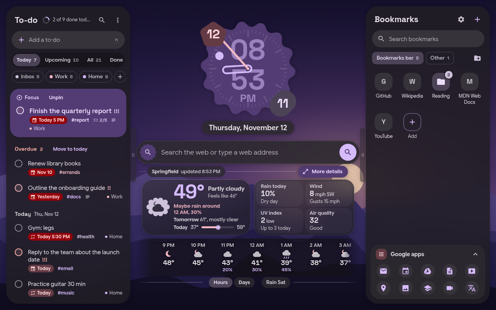
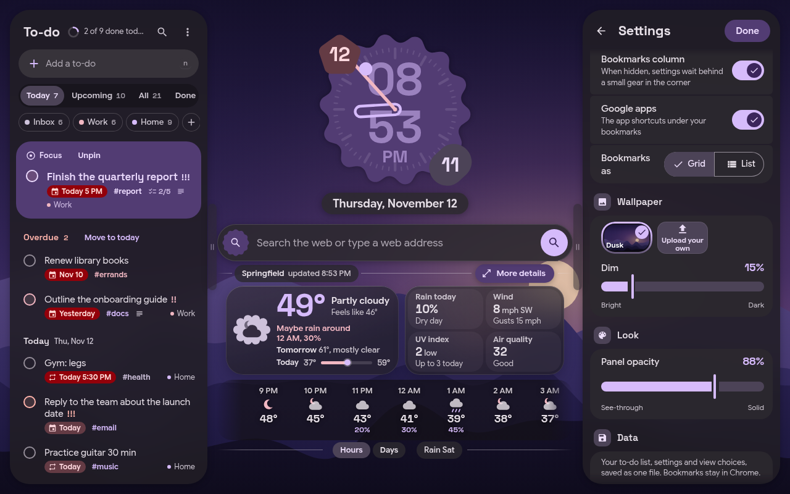

# Material Desk

A calm Material You new tab page for Chrome. A cookie clock, a long search bar, the weather, a to-do list and your
bookmarks, all in a dark Material 3 expressive look whose colors come from your wallpaper.

<!-- Screenshots: add images to docs/ and link them here. -->
| | |
|---|---|
|  |  |

## Features

- **Cookie clock** with the time, a second dot, and day and month bubbles.
- **Search** with the search engine set in Chrome (the default, through `chrome.search`), or with Google,
  DuckDuckGo, Bing, Brave, Wikipedia or YouTube. Optional suggestions with Google or DuckDuckGo.
- **Weather** from Open-Meteo: now, the next hours and days, and a detail view with a 24-hour chart, 10 days, air
  quality, UV, wind, sun and moon. Place from your location, a typed place, or your internet
  address. Units follow your browser's region (Fahrenheit in the United States) and can be changed.
- **To-do list** with lists, sections, tags, due dates and times, repeats, subtasks, priorities, focus and natural
  date entry ("Friday 5 pm").
- **Bookmarks** from Chrome, as a grid or a list, with folders, search and the Google apps.
- **Wallpapers and colors:** the built-in Dusk wallpaper or your own picture, a Dim slider, and a Material You dark
  color scheme made from the picture on your device.
- Side columns fold to an icon or widen to half or the whole page. Keyboard shortcuts (press `?`).

## Install

- **Chrome Web Store:** *(link coming when the listing is live)*.
- **For development (load unpacked):** clone this repository, open `chrome://extensions`, turn on Developer mode,
  choose "Load unpacked" and pick the `extension/` folder. No build step is needed.

## Develop and build

```sh
tools/dev.sh 8799            # http://127.0.0.1:8799/dev.html with mock chrome.* APIs (?store, ?seed, ?noBookmarks)
tools/shot.sh "http://127.0.0.1:8799/dev.html?store&seed" /tmp/shot.png 1920 1080
tools/build.sh store         # dist/material-desk-VERSION.zip for the Chrome Web Store
tools/build-vendor.sh        # rebuild the bundled material-color-utilities (needs npm and network once)
python3 -I tools/wallpapers.py   # redraw the built-in wallpapers
```
Requirements for the tools: a POSIX shell, Python 3, Google Chrome (headless screenshots) and Node.js (`tools/cdp.mjs`).
See [ARCHITECTURE.md](ARCHITECTURE.md) for how the page is put together.

An optional desktop integration can supply the colors, background and font through a Chrome admin policy
(`chrome.storage.managed`, see `extension/schema.json`), so the page follows a Linux desktop's own wallpaper theme.
Without it, the Wallpaper section in Settings is in charge.

## Privacy

- Your to-do list, settings and wallpaper stay in your browser (`chrome.storage.local` and IndexedDB). Nothing is
  sent to the developer, and there are no analytics.
- The weather is fetched from Open-Meteo (forecast, place search, air quality) with the coordinates of the place.
  When "Use my location" is on, Chrome's location is used; otherwise the typed place, or your approximate place from
  your internet address (ipinfo.io). Place names for coordinates come from BigDataCloud.
- Searches with "Chrome default" are handed to Chrome, which uses the search engine from its own settings.
- Search suggestions, when on, send what you type to Google's or DuckDuckGo's suggestion service, only when that is
  the chosen engine. "Chrome default" gets no suggestions: the page can not tell which engine Chrome uses.
- Bookmarks are read and edited through Chrome's bookmarks API and never leave Chrome.

## Credits

- Cookie clock design after the clock widget of [End4's dots-hyprland](https://github.com/end-4/dots-hyprland)
  (illogical-impulse), GPL-3.0.
- Material shapes (the clock's cookie, the date bubbles and the weather icon shapes) from a port of the Material
  shapes library, Apache-2.0.
- Color schemes by Google's [material-color-utilities](https://github.com/material-foundation/material-color-utilities),
  Apache-2.0 (bundled in `extension/vendor/`).
- Fonts: [Space Grotesk](https://github.com/floriankarsten/space-grotesk) and
  [Google Sans Flex](https://github.com/googlefonts/googlesans-flex), SIL Open Font License 1.1 (in `extension/fonts/`).
- Weather data by [Open-Meteo.com](https://open-meteo.com/), CC BY 4.0.

See [NOTICE](NOTICE) for details.

## License

GPL-3.0. See [LICENSE](LICENSE).
